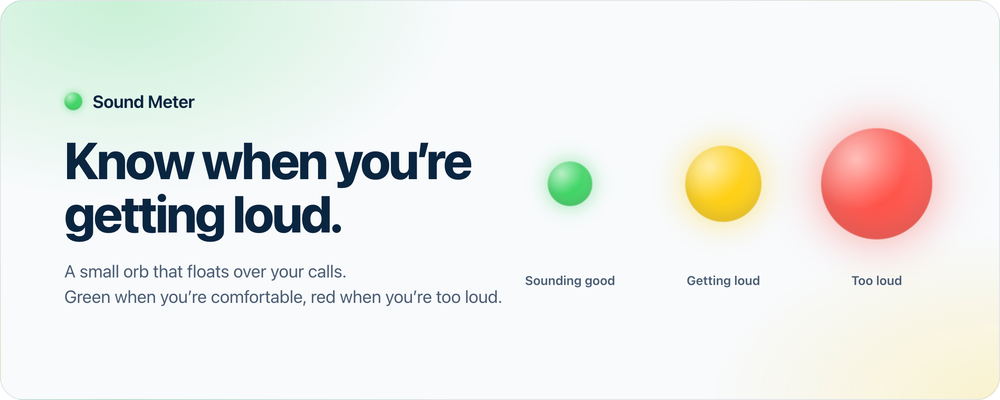
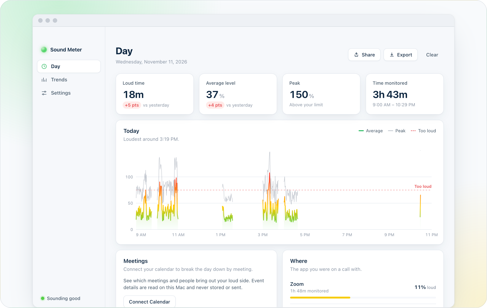
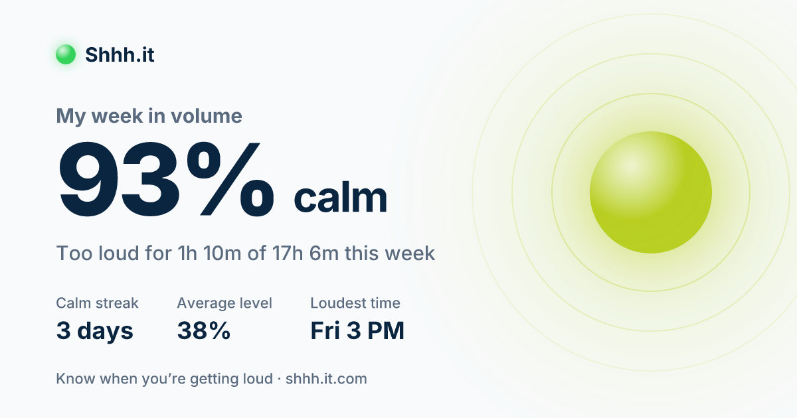
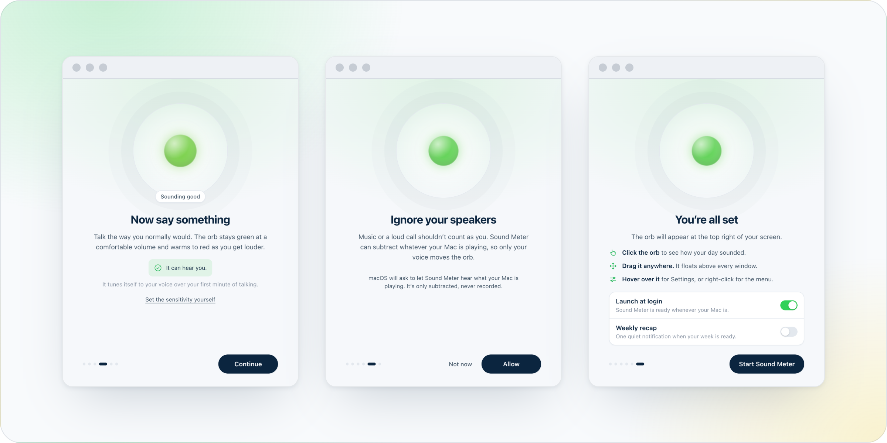

<p align="center">
  <picture>
    <source media="(prefers-color-scheme: dark)" srcset="docs/readme/hero-dark.png">
    
  </picture>
</p>

<p align="center">
  <a href="https://github.com/benjscohen/sound_meter/releases/latest"><b>Download for Mac</b></a>
  &nbsp;·&nbsp;
  <a href="https://shhh.it.com">Website</a>
  &nbsp;·&nbsp;
  <a href="https://shhh.it.com/privacy">Privacy</a>
</p>

<p align="center">
  <a href="https://github.com/benjscohen/sound_meter/releases/latest"></a>
  
  <a href="https://github.com/benjscohen/sound_meter/actions/workflows/test.yml"></a>
  <a href="LICENSE"></a>
</p>

## You can’t hear how loud you are. Everyone else can.

Headphones on, deep in a point you care about, your voice climbs and you’re the last to know. Sound Meter is a
small orb that floats over your calls and tells you first: it stays green while you’re at a comfortable volume and
warms to red when you’re not.

> “I am constantly told I am talking loudly but don’t even realize it.”
> — Benj Cohen, who built it

It is free, open source, and never records a thing.

## What it does

**One glance tells you.** No numbers to read mid-sentence. The orb grows and shifts green → amber → red with your
voice, above every window including full-screen calls. Drag it anywhere; clicks pass through the space around it.

**Only your voice counts.**

- **It ignores your speakers.** Voice Focus subtracts whatever your Mac is playing, so music or a loud call
  doesn’t count as you. (macOS 14.2 or later; macOS asks once for permission to hear system audio.)
- **It tunes itself.** It learns your normal speaking voice from less than a minute of talking. Five manual
  levels are there if you’d rather choose.
- **It shows up for calls.** Ask it to listen only during calls and it appears when one starts, then hides and
  lets go of the microphone when it ends.

**See how your day sounded.** Click the orb for a private, minute-by-minute history: which meetings, people and
apps get you loud, patterns by weekday and hour, and a calm streak to keep going.

<p align="center">
  <picture>
    <source media="(prefers-color-scheme: dark)" srcset="docs/readme/insights-dark.png">
    
  </picture>
</p>

**Share your week, on your terms.** One link shows your week’s card wherever you paste it. It carries your totals
and nothing else: no meeting names, no people, nothing stored online.

<p align="center">
  
</p>

**Small on purpose.** Any microphone. Three sizes and three opacities, with level symbols if colour alone is
hard to read. Optional nudges and a weekly recap, both off until you turn them on. It updates itself.

## Install

1. [Download the installer](https://github.com/benjscohen/sound_meter/releases/latest). There is one for Apple
   silicon (`arm64`) and one for Intel (`x64`); [shhh.it.com](https://shhh.it.com) picks the right one for you.
2. Drag Sound Meter into Applications.
3. Open it and allow the microphone.

A short welcome walks you through the rest: you see the orb react to your own voice, and each permission is
explained before macOS asks for it.

<p align="center">
  <picture>
    <source media="(prefers-color-scheme: dark)" srcset="docs/readme/welcome-dark.png">
    
  </picture>
</p>

Requires macOS 13 or later. Every release is signed and notarized by Apple.

## Privacy

An app that uses your microphone has to earn its place.

- **Volume, not words.** It works out one number, how loud you are right now, and discards the audio as it goes.
  Nothing you say is recorded, transcribed or stored.
- **It stays on your Mac.** No account, no ads, nothing sold or shared. Your history is a folder of loudness
  numbers that you can export or delete whenever you like.
- **Open to inspection.** Every claim on the [privacy page](https://shhh.it.com/privacy) can be checked against
  the code in this repository.

The only things that leave your Mac are an hourly check with GitHub for updates and, if you press Share, a link
containing the totals on your card.

## Development

```bash
git clone https://github.com/benjscohen/sound_meter.git
cd sound_meter
npm install
npm run build:helper   # optional: the Swift helper for calendar and call detection
npm start
```

Node 18 or later. The app is Electron; the helper needs Xcode’s command line tools.

| Command | What it does |
| --- | --- |
| `npm start` | Runs the app from source. |
| `npm test` | Unit tests: meter maths, history, settings, analytics, sharing. |
| `npm run smoke` | Boots the real app with a fake microphone, walks through the welcome flow, the orb, Settings and Insights, and saves screenshots to `./shots`. `SMOKE_THEME=dark` for dark mode. |
| `npm run check:site` | The website’s logic: share links, the share page, its preview image, and picking the right download. |
| `npm run assets` | Re-renders the installer background and social card. |
| `npm run readme:images` | Re-renders the pictures on this page from the smoke-test screenshots. |
| `npm run dmg:layout` | Records the installer window’s layout with Finder (see [Releasing](#releasing)). |

### How it is put together

| Where | What lives there |
| --- | --- |
| `main.js` | Main process: windows, menus, tray, updates, IPC. |
| `src/preload.js` | The only bridge between windows and the main process. Windows are sandboxed and get this API and nothing else. |
| `src/index.html`, `src/renderer.js` | The floating orb. |
| `src/onboarding.*` | The welcome flow. |
| `src/panel.html`, `src/insights.js`, `src/settings.js` | The one main window: Day, Trends and Settings. |
| `src/main/` | Settings and history stores (plain JSON in the app’s user-data folder), plus the pure functions behind every number: analytics, calibration, sharing, reminders. Each has tests beside it. |
| `src/shared/` | Theme and the Voice Focus helper used by both the orb and the welcome flow. |
| `native/sm-helper.swift` | A small Swift binary for the two things Electron can’t do: read the calendar (EventKit) and see which app is using the microphone (CoreAudio). Without it those features are hidden. |
| `landing_page/` | The website, [shhh.it.com](https://shhh.it.com): a Vite site plus two stateless edge functions that render shared weeks (`/s`) and their preview images (`/api/og`). Deployed by Vercel on every push to `main`. |
| `scripts/` | The smoke test, artwork renderers, the installer builder and signing helpers. |

A few things worth knowing before changing them:

- **Voice Focus** uses Chromium’s system-audio echo cancellation. If macOS refuses the permission, or is still
  asking, the orb listens normally and switches over by itself once it is allowed.
- **History** is one small JSON file per day, a row per minute, removed after 90 days.
- **Released builds are locked down.** Electron’s run-as-node, `--inspect`, `NODE_OPTIONS` and Chromium’s
  remote-debugging switches are all refused, so nothing else on a Mac can drive the app or borrow its microphone
  access. CI checks this before publishing.

## Releasing

Pushing a tag such as `v1.6.1` runs the release workflow, which tests, builds for both chips, signs with a
Developer ID, notarizes with Apple and uploads everything to a draft release. The release only goes public once
every installer and the update manifest are there, so no one, and no running copy of the app, ever sees a
half-uploaded release.

The installers are built by `scripts/dmg.js` rather than electron-builder’s own dmg target, whose window layout
recent versions of Finder ignore (the background never shows). The layout Finder draws from is recorded once into
`assets/dmg/DS_Store`; after changing the installer’s design, run `npm run dmg:layout` on a Mac and commit the
result.

Signing needs `APPLE_ID`, `APPLE_APP_SPECIFIC_PASSWORD`, `APPLE_TEAM_ID` and a Developer ID certificate. Without
them a local `npm run build` still produces unsigned builds.

## Questions and ideas

[Open an issue](https://github.com/benjscohen/sound_meter/issues). Bug reports are most useful with your macOS
version and what the orb was doing at the time.

## License

[MIT](LICENSE)
